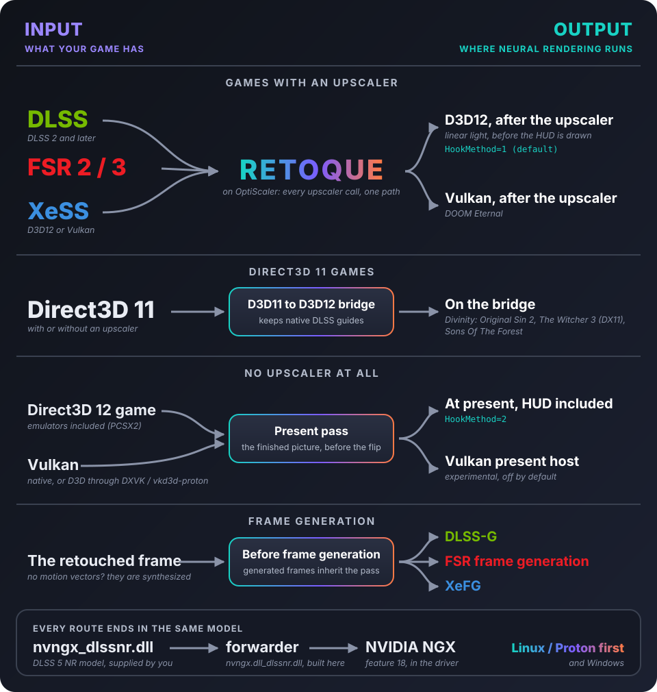
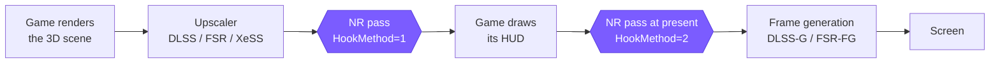
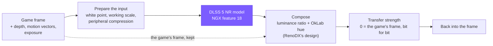

<div align="center">

  

</div>
<hr />
<br />
<div align="center">
  <a href="https://github.com/gabrielmaialva33/retoque/actions/workflows/nr-tests.yml"></a>
  
  
  <a href="LICENSE"></a>
  <a href="https://github.com/optiscaler/OptiScaler"></a>
</div>
<div align="center">
  <a href="https://github.com/gabrielmaialva33/retoque/releases"></a>
  <a href="https://github.com/gabrielmaialva33/retoque/releases/tag/nightly"></a>
  <a href="docs/README.md"></a>
  <a href="#known-issues"></a>
</div>
<br />

## Quick start

Download a versioned **Retoque zip** from [Releases](https://github.com/gabrielmaialva33/retoque/releases)
and extract the whole archive into a separate folder. Close the game.

1. **Windows:** run `install-windows.cmd`. **Linux / Proton:** open a terminal in the extracted folder and
   run `bash install-linux.sh` (zip extraction may lose executable permissions).
2. Give the folder containing the game's executable, choose a proxy (`dxgi.dll` by default), and answer
   **yes** to **Turn Neural Rendering on?** The installer preserves your settings and records how to uninstall.
3. Put your own **`nvngx_dlssnr.dll`** beside the game's executable. It is not included. With **310.9.16**,
   **Preset 2** selects the October weights; RTX 20/30/40 need the compatible model build. See the
   [model compatibility and preset notes](docs/dlssnr/design/model-310-9-16.md) before choosing a build.
4. On Proton, set Steam launch options to `WINEDLLOVERRIDES="dxgi=n,b" %command%` (replace `dxgi` if you
   selected another proxy). The Linux installer copies the driver's Wine `_nvngx.dll` when available.

**Home** opens the menu with the release's ini. A preserved ini keeps your existing menu key (the repository
fallback is Insert). **F7 only toggles NR if you set `[DlssNr] ToggleKey=0x76`**; no toggle is bound by default.
If a mod already occupies the proxy name, the installer explains the conflict before writing anything.

## Table of Contents

**1.** [**About**](#about)  
**2.** [**How it works**](#how-it-works)  
**3.** [**Where the pass runs**](#where-the-pass-runs)  
**4.** [**Inside the pass**](#inside-the-pass)  
**5.** [**Status**](#status)  
**6.** [**Requirements**](#requirements)  
**7.** [**Installation**](#installation)  
**8.** [**Using it**](#using-it)  
**9.** [**Known issues**](#known-issues)  
**10.** [**Building and tests**](#building-and-tests)  
**11.** [**Repository layout**](#repository-layout)  
**12.** [**Credits**](#credits)  
**13.** [**License**](#license)

## About

**Retoque** runs NVIDIA's **DLSS 5 Neural Rendering** model over a game's picture, in games that never
shipped with it. It is a fork of [**OptiScaler**](https://github.com/optiscaler/OptiScaler), by way of
[Dagherbou's DLSS-NR fork](https://github.com/Dagherbou/OptiScaler_DLSSNR), so it loads the same way: as a
proxy DLL between the game and the graphics API, with no game patch and no cooperation from the game.
Everything OptiScaler does (swapping upscalers, frame generation, spoofing) is still here; see
[OptiScaler's README](https://github.com/optiscaler/OptiScaler#readme) for that side.

> [!IMPORTANT]
> Retoque does **not** include the Neural Rendering model. You supply `nvngx_dlssnr.dll` yourself
> (see [Requirements](#requirements)).

> [!WARNING]
> Experimental, and unsupported by NVIDIA. It drives an undocumented NGX feature directly. Back up the
> game folder's files before you install, and keep the game's own copies of any DLL you replace.

> [!CAUTION]
> * **Do not use it with online games.** Like any proxy DLL, it can trip anti-cheat software and get an account banned.
> * Retoque is **free**. This GitHub repository is its only home: there is no website, app or paid build of it.

**Key aspects of Retoque:**
- Runs the model on four routes: after the game's upscaler on **D3D12**, after the upscaler on
  **Vulkan**, on **D3D11** games through a D3D11-to-D3D12 bridge, and **at present time** for games with
  no upscaler at all (emulators included).
- Games with DLSS, FSR 2/3 or XeSS all qualify for the upscaler routes, because OptiScaler turns their
  calls into the same path.
- **Linux / Proton first**: Vulkan hook skipping, overlay routing and a vkd3d-proton / DLSS-G interlock,
  on top of everything that works on Windows.
- **Colour that stays the game's**: RenoDX-style composition, a white point from the game's own
  exposure, optional highlight recovery. At strength zero the frame comes back **bit for bit**.
- **Cost controls**: working scale, peripheral compression and model cadence, with fence-confirmed GPU
  timing and per-kernel profiling to measure them.
- **Frame generation aware**: the pass runs before frame generation sees the frame, and frame
  generation can be synthesized for games that give no motion vectors.
- An in-game menu with side-by-side and wipe comparison, and a host test suite that runs without a GPU.

## How it works

Like OptiScaler, Retoque is one DLL that the game loads under a system DLL's name. It forwards
everything to the real system DLL, except the calls it is interested in: the game's upscaler calls and
its presents. That is where the Neural Rendering pass runs.

<div align="center">
  
</div>

> [!NOTE]
> **Why a forwarder?** The model only answers callers whose module path contains `nvngx.dll`, so its
> calls go through `nvngx.dll_dlssnr.dll`, a small DLL built by this project. It contains no NVIDIA
> code. On D3D12, `[DlssNr] ModelLoader=direct` makes the same calls from `OptiScaler.dll` instead.

## Where the pass runs

A frame goes through the same stages in almost every game. Retoque can step in at two points: right
after the upscaler, while the picture is still linear and the HUD is not drawn yet, or at present time,
on the finished picture just before frame generation.



`HookMethod=1` (the default) leaves the HUD untouched, because the HUD is drawn after the pass.
`HookMethod=2` covers games with no upscaler, and sees the finished picture, HUD included.

The picture above answers **which route your game takes**; the menu and `OptiScaler.log` say which one it did.

> [!TIP]
> A D3D11 game with no upscaler runs the pass on the bridge's own swapchain with `HookMethod=2`; that is
> decided when the swapchain is created, so changing it needs a restart. A D3D11 game that has an
> upscaler gets the pass when OptiScaler runs that upscaler through the bridge (one of the "w/Dx12"
> upscalers in its menu).

## Inside the pass

The model never sees the game's frame directly. Retoque prepares an input for it, runs it, and composes
the answer back into the game's own picture, keeping the game's colours and highlights.



Optional stages, all off or neutral by default:

- **Model cadence** runs the model on one frame in N and carries its result along the motion vectors in
  between. An FPS option; it costs some stability in motion.
- **Output stabilizer** holds still pixels steady, gated by the model's input, so moving pixels always
  show the current answer.
- **Highlight recovery** (from RTX Remix) keeps bright highlights closer to the game's frame.

## Status

Measured working on Linux (Proton, RTX 4090):

| Game | Route |
|---|---|
| Crimson Desert | after the upscaler (D3D12), with DLSS-G |
| Cyberpunk 2077 | after the upscaler (D3D12), with ray reconstruction and DLSS-G |
| Divinity: Original Sin 2 | D3D11 bridge, with synthesized frame generation |
| The Witcher 3 (DirectX 11) | D3D11 bridge |
| Sons Of The Forest | D3D11 bridge, with the game's native DLSS depth and motion |
| DOOM Eternal | Vulkan, plus the menu overlay |
| Hellraiser: Revival | D3D12 present pass (its videos and UI are drawn after the upscaler) |
| PCSX2 | D3D12 present pass |

Games that need something other than the defaults get it from a built-in [game profile](docs/dlssnr/design/game-profiles.md),
logged as `DLSS-NR game profile:`; a key you set yourself always wins. Builds are also run on native Windows with an
RTX 3060.

> [!NOTE]
> Proton is not a D3D12 validator: it accepts some calls that Windows rejects. Windows reports are
> especially welcome.

## Requirements

- An **NVIDIA RTX GPU**. The cost depends a lot on the architecture: `WorkingScale=auto` runs the model
  at full scale on RTX 40 and later, and at half scale on RTX 20 and 30.
- **`nvngx_dlssnr.dll`**, the Neural Rendering model, which you supply. NVIDIA's **310.9.16** works (see
  the [model notes](docs/dlssnr/design/model-310-9-16.md) for presets and RTX 20/30/40); the older 310.8.2.0
  is a community patch of 310.8.0.0, which faults. Retoque does not redistribute any of them.
- **`nvngx.dll_dlssnr.dll`**, the forwarder, built by this project.
- A recent NVIDIA driver. Development runs on the Linux 615.78 driver; there is no tested minimum yet.

## Installation

<details open>
<summary><b>Linux (Proton)</b></summary>

1. Extract the release zip into a separate folder, close the game, then run `bash install-linux.sh` there.
2. Enter the game's executable folder and proxy name. Accept the NR prompt to set `[DlssNr] Enabled=true`.
   Existing keys are replaced in place; a preserved user ini is backed up for uninstall.
3. Supply your own `nvngx_dlssnr.dll` beside the game. The installer copies the driver's Wine `_nvngx.dll`
   from standard NVIDIA locations; `--no-nvngx` opts out. If it is missing, the installer tells you.
   Run the installer again after a driver update to refresh a copy it previously installed.
4. For `dxgi.dll`, use Steam launch options `WINEDLLOVERRIDES="dxgi=n,b" %command%`.

Command-line install: `bash install-linux.sh --enable-nr "/path/to/game/bin64" dxgi.dll`.
Preview with `--dry-run`; undo with `bash install-linux.sh --uninstall "/path/to/game/bin64"`.
The installer refuses running games, unknown conflicting files and a second OptiScaler proxy. Use
`--keep-reshade` to keep ReShade, or `--replace-foreign` only after checking the named conflict.
Replaced files are recorded under `.retoque/backup/`; uninstall restores them and leaves subsequent user edits alone.

</details>

<details>
<summary><b>Windows</b></summary>

From a release zip:

1. Extract the zip anywhere, close the game, and double-click `install-windows.cmd`. Give it the folder that
   holds the game's executable (drag it into the window) and pick Install, Uninstall or a dry run.
   - It installs `OptiScaler.dll` as `dxgi.dll` (or the name you give), the forwarder and the `OptiScaler\`
     folder, and `OptiScaler.ini` only if the game has none.
   - It refuses while the game is running, when a file in the way is not OptiScaler's (ReShade, another mod),
     and when another proxy name there already holds OptiScaler. The message names the command-line flag that
     overrides each one (`-KeepReShade`, `-ReplaceForeign`, `-AllowSecondProxy`).
   - Whatever it replaces goes to `.retoque\backup\` in the game folder, and Uninstall puts it back.
   - It never ships, copies or removes `nvngx_dlssnr.dll`; put your own beside the game's executable.
2. Answer **yes** to **Turn Neural Rendering on?**, or pass `-EnableNR` on the command line. The existing
   `[DlssNr] Enabled` line is replaced in place; uninstall restores a preserved ini that the installer edited.

By hand instead:

1. Copy `OptiScaler.dll`, `OptiScaler.ini`, `nvngx.dll_dlssnr.dll` and your `nvngx_dlssnr.dll` beside
   the game's executable.
2. Rename `OptiScaler.dll` to the proxy name (`dxgi.dll`, `winmm.dll`, ...). `setup_windows.bat` does it.
3. Turn the module on in `OptiScaler.ini` (see [Using it](#using-it)).

</details>

> [!CAUTION]
> Keep **one** proxy name per game folder; see [Known issues](#known-issues).

## Using it

In `OptiScaler.ini`, change the existing keys in place. Do not add a second copy of a key: the parser
keeps the last one.

```ini
[DlssNr]
Enabled=true
ToggleKey=0x76    ; F7 switches the pass on and off (no key by default)
```

> [!TIP]
> * **`Home`** opens the menu with the release ini (`[Menu] ShortcutKey=0x24`); a preserved ini keeps
>   its key, and the repository fallback is **Insert**. Its Neural Rendering tab has the options
>   below, the comparison views and the GPU timing row.
> * With `[Log] LogToFile=true`, `OptiScaler.log` beside the game says which route the pass took and
>   why, and carries the model's own messages as `DLSS-NR model:` lines.

Every key lives under `[DlssNr]` and ships as `auto`; the table says what `auto` means.
[`Config.md`](Config.md) and the comments in the ini are the full reference.

| Key | `auto` means | What it does |
|---|---|---|
| `Enabled` | false | Turns the module on. |
| `ToggleKey` | no key | Hotkey that switches the pass on and off. |
| `HookMethod` | 1 | Where the pass runs: 0 auto, 1 on the upscaler's output, 2 at present. |
| `TransferStrength` | 1.0 | How far the frame moves toward the model's picture; 0 gives the game's frame back exactly. |
| `WorkingScale` | 1.0 on RTX 40+, 0.5 on RTX 20/30 | The fraction of the frame the model works at. |
| `WhitePointSource` | 1 | Where the white point comes from: 0 paper white, 1 the game's exposure, 2 an exposure scan. |
| `ModelLoader` | forwarder | `forwarder`, or `direct` (OptiScaler calls the model itself). |
| `HighlightRecovery` | false | Keeps bright highlights closer to the game's frame (from RTX Remix). |
| `Cadence` | 1 | Run the model on one frame in N and carry its result in between (1 is every frame). |
| `StabilizerStrength` | 0 | Holds still pixels steady (0 is off). |
| `GpuTiming` | false | Fence-confirmed GPU timing for the pass. |
| `Compare` | 0 | 1 side by side, 2 wipe (0 is off). |

## Known issues

> [!CAUTION]
> Keep **one** proxy name per game folder. Two copies loaded together used to fight over the same hooks
> until the game died at startup; now the second one only forwards its exports, and the first logs
> `Another OptiScaler loaded in this process and only forwards its exports` with its path. The log line
> `CheckWorkingMode OptiScaler working as <name>` says which one runs.

- **Native Vulkan games under Proton** can hit fence timeouts when OptiScaler's Vulkan overlay runs next to
  DLSS-G. Set `[Vulkan] SkipHooks=true` for those.
- **A prefix without `nvapi64.dll`** (Divinity is one) makes NGX refuse the model with `FAIL_PlatformError`.
  Point `[Libraries] NvapiPath` at Proton's own `files/lib/wine/nvapi/x86_64-windows/nvapi64.dll`; the
  Divinity profile does it for you.
- **The present pass has no game depth or motion** in games without an upscaler, so the model can ghost when
  the camera moves. `[DlssNr] ZeroGuideReset=true` removes the ghosts at the cost of temporal smoothing; the
  D3D11 bridge uses native DLSS's guides when the game has them.
- **HDR10 and scRGB swapchains** are shown untouched at present time unless you turn on the experimental
  `[DlssNr] HdrPresent` (D3D12 and the D3D11 bridge); other HDR formats are always left alone.
- **The Vulkan present host** (`VulkanPresentHost`, for Vulkan games without an upscaler and D3D games under
  DXVK/vkd3d-proton) is an experiment: off by default, and it stands down while frame generation runs.
- **Windows** is tested on one RTX 3060. Proton accepts calls that native D3D12 rejects, so a Windows
  report is worth more than another Linux one.

## Building and tests

Windows-only C++ (MSVC, `OptiScaler.sln`, x64). On Linux, `./build-local.sh` builds with MSVC under Wine
(it runs [`tools/build-local.sh`](tools/README.md)). The Build section of [`CLAUDE.md`](CLAUDE.md#build)
has the details: the Wine stall recovery, formatting with clang-format 22, CI.

> [!WARNING]
> Do not run `git submodule update --init --recursive` blindly: `external/FidelityFX-SDK` is very large
> and is deliberately left unchecked-out.

```bash
python3 tests/run_all.py            # host tier: Python and g++/clang++, about a minute
python3 tests/run_all.py --list     # suites, tiers, and what can run here
python3 tests/run_all.py --tier all # adds the Wine suites
```

The host tier checks decision logic, configuration round-trips, bridge lifetime and more against fakes,
under sanitizers. It says nothing about image quality or performance. The Wine tier builds real DLLs and
drives real D3D12 and Vulkan. See [`tests/README.md`](tests/README.md).

## Repository layout

```text
retoque/          everything this fork adds: the Neural Rendering module (dlssnr/, shaders/dlssnr/),
                  synthesized frame generation (shaders/synth_motion/, inputs/FG/Synth_*), the menu's
                  translations, and smaller pieces, at the same relative paths as in OptiScaler/
docs/             design notes (indexed by topic), Linux/Proton notes, guides, history
tools/            build, deploy (Linux), Windows installer, release and log-summary scripts
tests/            the test suites and their runner
OptiScaler/       OptiScaler's own tree with our changes, at upstream's paths so merges stay easy
Config.md         every INI key
```

Start with [`retoque/dlssnr/README.md`](retoque/dlssnr/README.md) for the code,
[`docs/README.md`](docs/README.md) for the documentation, and
[`docs/dlssnr/design/DEVELOPMENT.md`](docs/dlssnr/design/DEVELOPMENT.md) for the rules every change
follows.

## Credits

Retoque stands on other people's work. Full licence texts are in [`Licenses/`](Licenses/).

- **[OptiScaler](https://github.com/optiscaler/OptiScaler)**, created by
  [cdozdil](https://github.com/cdozdil), and its contributors. GPL-3.0.
- **[Dagherbou's OptiScaler_DLSSNR](https://github.com/Dagherbou/OptiScaler_DLSSNR)**, the DLSS-NR fork
  this module started from.
- **[RenoDX](https://github.com/clshortfuse/renodx)** (clshortfuse): the colour composition. clshortfuse
  also made the patched 310.8.2.0 model build.
- **[NVIDIA RTX Remix](https://github.com/NVIDIAGameWorks/dxvk-remix)**: the highlight recovery step.
- **[optimizer-fps-dlss5](https://github.com/BeliyG3/optimizer-fps-dlss5)** (BeliyG3, MIT): the peripheral
  compression mapping and the model cadence carry.
- **[DLSS5-Feeder](https://github.com/jlrouzies-fr/DLSS5-Feeder)** (jlrouzies-fr, MIT): the output
  stabilizer's gate and the reduced-scale guide fixes.
- **[dlss5-bridge](https://github.com/NIGos/dlss5-bridge)** (NIGos, MIT): the NGX loader's feature-18
  route.
- **[OptiScaler-DLSSNR-PreSR-Multipass](https://github.com/wilsjo2/OptiScaler-DLSSNR-PreSR-Multipass)**
  (wilsjo2, GPL-3.0): the direct model loader, DLSS enlargement and the peripheral compression
  integration.
- **[OptiScaler-F5-DLSSNR-Multipass](https://github.com/janblade/OptiScaler-F5-DLSSNR-Multipass)**
  (janblade, GPL-3.0): "Measure detail", per-thread scopes, the model cadence and ViT-skip ideas, and the
  shared D3D12 menu lock.
- **ShyVortex** (via hhkbble's OptiScaler) and **[HelixSR-Scaler](https://github.com/lonewolf0622/HelixSR-Scaler)**
  (lonewolf0622, GPL-3.0): the alt-tab present re-entry fix and FG object lifetime fixes, adapted.
- **[scottmudge's OptiScaler_DLSSNR](https://github.com/scottmudge/OptiScaler_DLSSNR)**: the present hook
  and descriptor reuse, rewritten here.
- **[Skynizz](https://github.com/Skynizz/optiscaler-dlss5)**, **hhkbble** and **sqmq13**: the exposure
  latch, the residual transfer and signed-value fixes, adapted.
- **[KleberMotta](https://github.com/KleberMotta/OptiScaler-DLSS5-MFG-RTX40)**,
  [ImDreamt](https://github.com/ImDreamt/MFGAdaUnlock-RenoDx),
  [mavismmg](https://github.com/mavismmg/MFGAdaUnlock-RenoDx) and
  [dashdogy](https://github.com/dashdogy/RTX40MFG-Unlock): the DLSS-G snippet rule.
- **[AMD FidelityFX SDK](https://github.com/GPUOpen-LibrariesAndSDKs/FidelityFX-SDK)** (MIT parts): the
  optical flow behind `SynthMotion`.
- **[dxvk-nvapi](https://github.com/jp7677/dxvk-nvapi)** (jp7677): the NVIDIA Optical Flow headers (MIT).
- **[lsfg-vk](https://github.com/PancakeTAS/lsfg-vk)** (PancakeTAS): the LSFG 3.1 pass structure the LSFG study
  follows, from `v1.0.0` (MIT) and `8b0da266` (GPL-3.0-or-later). No Lossless Scaling shader is included.
- **y4my4my4m**, **RizziU** and **jackra1n**: Linux/Proton fixes from their OptiScaler pull requests
  ([#1138](https://github.com/optiscaler/OptiScaler/pull/1138),
  [#1131](https://github.com/optiscaler/OptiScaler/pull/1131),
  [#1163](https://github.com/optiscaler/OptiScaler/pull/1163)).

## License

GPL-3.0, inherited from OptiScaler: see [`LICENSE`](LICENSE). Third-party parts keep their own licences,
listed in [`Licenses/`](Licenses/). `Licenses/RenoDX_ATTRIBUTION.txt` must ship with any build you
distribute.

DLSS, NVIDIA and RTX are trademarks of NVIDIA Corporation. Retoque is an independent project, not
affiliated with, endorsed by or supported by NVIDIA. Other names belong to their owners.

<details>
<summary><b>Em português</b></summary>

O Retoque aplica o modelo DLSS 5 Neural Rendering da NVIDIA na imagem de qualquer jogo, no Linux
(Proton) e no Windows, usando o OptiScaler como base. Ele roda depois do upscaler do jogo (D3D12 ou
Vulkan), em jogos D3D11 por uma ponte D3D11-para-D3D12 e, na hora do present, em jogos sem upscaler (como
emuladores). O arquivo do modelo (`nvngx_dlssnr.dll`) **não** vem junto: você precisa fornecê-lo. É um
projeto experimental, sem vínculo com a NVIDIA, sob GPL-3.0.

</details>
