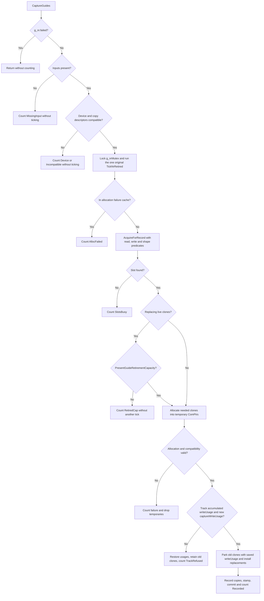

# Budget-aware present-guide capacity and pressure diagnostics

Status: 2026-11-04. **Step 1 implemented on branch `feat/nr-present-guide-budget-20261104`** (built against
`e665dfee`; see §9 for exact implementation details and host verification). **Step 2 (optional bounded ring
growth under a VRAM budget) is intentionally not built**, gated on Step 1 in-game measurements (§4.3).

Read first: [nr-present-hook.md](nr-present-hook.md) (the present-pass host and original 4-slot ring),
[present-real-guides.md](present-real-guides.md) (the 7-rule consumer identity contract that reads the
ring), [dx12-resource-ownership.md](dx12-resource-ownership.md) (`ParkNrClone`, `g_nrRetired`, and fence-safe
deferred retirement), [submission-tracking.md](submission-tracking.md) (`Submission::Track` and
`Submission::Completed`), [dx12-internal.md](dx12-internal.md) (the internal translation-unit split across
`DlssNr_Dx12_*.cpp`), and [DEVELOPMENT.md](DEVELOPMENT.md) (the invariants this design must satisfy).

---

## 1. The problem, and why diagnostics come before capacity growth

When DLSS-NR runs at present (`HookMethod=2`, `HookMethod=0` with the present hook active, or through
the D3D11 bridge / native D3D11 guide transport), the upscaler evaluate hook records the game's depth
and motion vectors into an owned present-guide ring (`CaptureTemporal` / `CaptureBridgedGuides` $\to$
`CaptureGuides`), and the present pass (`RunPresentPass` or `CapturedPresentGuides`) picks the newest
eligible slot that passes `PresentGuideIdentity::Decide`.

Today, **the consumer side is richly instrumented while the producer side is almost blind**:

1. **Consumer side (`PresentGuideIdentity::Consumer`):** Every present attempt records an `Outcome`
   (`Picked`, `FellBack`, `Skipped`, `None`) and, on refusal, the first failing rule (`Consumed`,
   `QueueOrder`, `PresentReady`, `EvalOrder`, `CrossedEval`, `Lag`, `Age`, `Extent`) into a rolling
   2 s / 30 s window log (`Consumer::Observe` at `retoque/dlssnr/DlssNr_PresentGuideIdentity.h:546-662`)
   and a 1 s menu/report status snapshot (`PresentGuidesLine` at `:920-960`, `PresentGuidesSnapshot` at
   `:837-918`).
2. **Producer side (`Ring` + `CaptureGuides`):** The ring has a fixed capacity of `kRingSize = 4`
   (`retoque/dlssnr/DlssNr_PresentGuideRing.h:17`). When `CaptureGuides`
   (`retoque/shaders/dlssnr/DlssNr_Dx12_PresentGuides.cpp:442-680`) cannot record a capture — because
   all non-`_lastReadIndex` slots are held in-flight, because a size/format change triggers clone
   reallocation that fails, or because `Submission::Track` refuses the evaluate command list — it returns
   `false` with no structured counter, no rolling window summary, and no surface in the overlay menu or
   `DiagnosticReport`.

Because producer skips leave no structured trace, **a dropped capture looks identical to the upscaler
not running**:

- If the producer skips frame $N$'s capture while the previous capture at frame $N-1$ was already
  consumed by present $N-1$, then present $N$ sees `ring.Newest().sequence == lastPickedSequence`.
  `Consumer::Pick` classifies that as `Outcome::Skipped` (`DlssNr_PresentGuideIdentity.h:791-795`), and
  `PresentGuidesLine` reports:
  `"Fell back to estimated guides (X of Y presents): no new frame from the upscaler"` (`:946-949`).
- On the native D3D11 guide path (`retoque/dlssnr/DlssNr_Dx11Guides.cpp:557-571`), any `false` return
  from `CaptureBridgedGuides` collapses into a single opaque `Reason::Ring` (`"the present guide ring
  refused the capture"`), whether the failure was all slots busy, an incompatible resource descriptor,
  an allocation failure, or an untracked command list.

Adding ring slots before measuring why captures are skipped would violate both VRAM discipline and
diagnostic honesty: **more slots consume committed `DEFAULT`-heap VRAM and cannot fix stale guides
(Rule 7), queue mismatches (Rule 2), or evaluate-to-present lag (Rule 6)**. Therefore this design splits
into two strict steps:

- **Step 1 (Diagnostics, slot-selection hygiene, and retirement bounds — zero capacity growth):**
  Keep `kRingSize = 4`. Classify and count every producer capture attempt (`Recorded` with reuse vs.
  rebuild, or skipped by exact reason: `MissingInput`, `Device`, `Incompatible`, `SlotsBusy`,
  `RetiredCap`, `Budget`, `AllocFailed`, `TrackRefused`), track resident and parked clone bytes, fix
  pre-parking order of operations in `CaptureGuides`, prefer shape-matching free slots over evicting
  mismatched ones, and surface producer skip reasons in the periodic log, `PresentGuidesLine()`, and
  `DiagnosticReport`.
- **Step 2 (Optional bounded growth `[4, 8]` under a VRAM budget — gated on Step 1 evidence):**
  Only if Step 1 measurements in a real game demonstrate legitimate `SlotsBusy` pressure (where both
  producer writes and present reads complete normally, yet >4 captures are simultaneously in flight and
  would pass `PresentGuideIdentity::Decide`), allow the ring to activate up to `kMaxRingSize = 8` slots
  when a pure VRAM budget check (`PresentGuideBudget::Evaluate`) and DXGI `QueryVideoMemoryInfo` confirm
  headroom — never reusing an in-flight slot.

---

## 2. The gap in Retoque today (`file:line`)

### 2.1 Fixed 4-slot ring and incomplete slot-busy check

- `retoque/dlssnr/DlssNr_PresentGuideRing.h:15-38`: `PresentGuides::Ring` holds `Slot _slots[kRingSize]`
  with `kRingSize = 4` (`:17`). Each `Slot` stores only `{sequence, recordTimeNs, writeSubmitted,
  writeComplete, writeToken, readToken}` (`:19-28`).
- `DlssNr_PresentGuideRing.h:40-69`: `Ring::AcquireForRecord(P isReadInFlight)` iterates `i = 0..3`,
  skipping:
  - `i == _lastReadIndex` (`:50`, protecting the slot most recently handed to the present consumer), and
  - slots where `isReadInFlight(_slots[i].readToken)` is true (`:54`, protecting slots whose present
    command list has not yet completed on the GPU).
  It returns the first unrecorded slot (`_slots[i].sequence == 0`, `:57`) or the slot with the smallest
  `sequence` (`:60-64`), or `kRingSize` (`:68`) when all non-`_lastReadIndex` slots have in-flight
  present reads.
- **What `AcquireForRecord` does not check today:**
  1. **Producer write in flight (`captureWriteUsage`):** `g_presentGuideStamps.WriteUsage(i)`
     (`DlssNr_PresentGuideIdentity.h:220`) tracks the `Submission::Usage` of the evaluate command list
     that last wrote `g_presentGuideClones[i]`. `AcquireForRecord` only checks consumer `readToken`
     (`readUsage` in `CaptureGuides` at `DlssNr_Dx12_PresentGuides.cpp:513-517`), not whether the
     previous producer write into slot `i` is still unsubmitted (`Pending`) or still executing on the GPU
     (`!Submission::Completed(device, writeUsage)`). If an evaluate command list on one queue is still in
     flight (or was abandoned/unsubmitted) while 4 newer evaluates run, overwriting slot `i` races the
     earlier copy on the GPU.
  2. **Extent/format match preference:** `AcquireForRecord` always picks the first unrecorded slot or
      strictly oldest `sequence` (`:56-64`), without knowing whether `g_presentGuideClones[i]` already has
     clones matching `(device, depthDesc, motionDesc)`. If a transient size/format change or multi-view
     evaluate occurs, picking purely by oldest sequence needlessly parks and reallocates clones even when
     another free slot already matches.

### 2.2 `CaptureGuides` side effects before admission and silent skip paths

In `retoque/shaders/dlssnr/DlssNr_Dx12_PresentGuides.cpp:442-680`, `CaptureGuides` executes under
`std::lock_guard<std::mutex> lock(g_nrMutex)` (`:502`) with the following early returns and hazards:

1. **Pre-lock silent drops (`:444-501`):**
   - `:444-445`: `!cmdList || !depth || !motion || g_nr.failed` (plus caller gates in `CaptureTemporal` at
     `:689-697` and `CaptureBridgedGuides` at `:718-719`).
   - `:450-458`: `!DeviceChildBelongsTo(cmdList, device)` or depth/motion device mismatch (`LOG_WARN` once,
     returns `false`).
   - `:463-469`: Non-`TEXTURE2D`, `DepthOrArraySize != 1`, or `SampleDesc.Count != 1` (silent `false`).
   - `:474-479`: `!PresentGuideCopyCompatible(depthDesc, true)` or motion incompatible (`LOG_WARN` once,
     returns `false`).
   - `:481-501`: `(device, depthKey, motionKey)` present in `s_failedAllocs` (`:31-51`) after an earlier
     `CreateCommittedResource` failure (silent `false`).
2. **All slots busy (`:511-523`):**
   - Calls `g_presentGuideRing.AcquireForRecord(...)`. When `slot >= PresentGuides::kRingSize`, lines
     `518-523` simply `return false;` with **no log, no counter, and no stamp**.
3. **Clone parking and reallocation *before* command-list tracking (`:527-610`):**
   - At lines `527-544`, if `clone.device != device`, or `clone.depth` mismatches `(Width, Height,
     Format, Flags)`, `CaptureGuides` immediately calls `ParkNrClone(clone.depth, clone.readUsage,
     clone.captureWriteUsage)` (`:533`) and `ParkNrClone(clone.motion, ...)` (`:542`), then allocates new
     textures via `CreatePresentGuideClone` (`:547, :549`).
   - Only **after** parking the old clones and allocating new ones does `CaptureGuides` call
     `Submission::Track(device, cmdList, writeUsage)` at line `595`.
   - If `Submission::Track` returns `false` (`:595-610`, e.g. untracked/unhooked command list or tracking
     table full), `CaptureGuides` returns `false` — having already destroyed the previous slot's valid
     clones and pushed them onto `g_nrRetired` for nothing.
4. **Unbounded clone parking under `ParkNrClone` (`retoque/shaders/dlssnr/DlssNr_Dx12_Lifetime.cpp:619-632`):**
   - `TrackNrRecording` (`DlssNr_Dx12_Lifetime.cpp:201`) checks `RetiredCapacity()` (`g_nrRetired.size() <
     32`, `:406-421`) before admitting work that can retire resources.
   - `ParkNrClone` (`:619-632`) pushes a `NrRetiredState` onto `g_nrRetired` **without** checking
     `RetiredCapacity()`. Under rapid dynamic-resolution scaling (DRS) or extent oscillation, repeated
     clone rebuilds in `CaptureGuides` can grow `g_nrRetired` past the 32-entry cap while `submission` is
      still in flight.
5. **Zero VRAM accounting on clone creation (`DlssNr_Dx12_PresentGuides.cpp:91-126`):**
   - `CreatePresentGuideClone` allocates committed `D3D12_HEAP_TYPE_DEFAULT` textures (`:98-123`) without
     querying `device->GetResourceAllocationInfo(0, 1, &cloneDesc)` or checking `VideoMemory`
     (`DlssNr_Dx12_Lifetime.cpp:217-244`). At 3840×2160, a `R32G32B32A32_FLOAT` motion clone (132 MiB) +
     `R32_FLOAT`/`D32_FLOAT` depth clone (33 MiB) is ~165 MiB per slot (~660 MiB across 4 slots, or
     ~1.3 GiB if grown to 8 slots without a budget cap).

### 2.3 Consumer and diagnostic blindness to producer skips

- `retoque/dlssnr/DlssNr_PresentGuideIdentity.h:546-662` (`Consumer::Observe` / `Consumer::FormatLine`):
  Logs `PresentGuides: window=... presents=... picked=... fallback=... (consumed=... queueOrder=...
  presentReady=... evalOrder=... crossedEval=... lag=... age=... extent=...) skipped=... none=...`.
  Nothing in that line tells the developer whether `skipped` or `none` (or `consumed`) happened because
  the upscaler did not run or because `CaptureGuides` refused the capture.
- `DlssNr_PresentGuideIdentity.h:920-960` (`PresentGuidesLine`):
  Used by `retoque/dlssnr/DlssNr_Menu.cpp:1505` and `retoque/dlssnr/DlssNr_DiagnosticReport.h:168`.
  When `s.picked == 0` and `s.skipped >= s.none`, it prints:
  `"Fell back to estimated guides (X of Y presents): no new frame from the upscaler"` (`:946-949`).
  If the upscaler ran every frame but `CaptureGuides` skipped every capture (e.g. `SlotsBusy` or
  `AllocFailed` or `TrackRefused`), that message directly misleads diagnosis.

---

## 3. What the donor does (studied as data)

In the reference donor tree (`Tmp/NeuRotic-an-OptiScaler-DLSSNR-fork` at `beae4eea`, inspected as data
only), present-guide capacity and budgeting are spread across four headers and one `.cpp`:

1. **Producer occupancy & refusal telemetry (`OptiScaler/dlssnr/DlssNr_PresentGuides.h:57-84`):**
   - `CaptureProducerIdentity` (`:57-65`) stamps the producer context (`owner`, `upscalerKey`, `epoch`,
     `sequence`, `frameToken`, `hasFrameToken`).
   - `CaptureOccupancy` (`:67-84`) records a per-capture snapshot of why slots were unavailable:
     `slotCount`, `reusableSlots`, `matchingSlots`, `firstBlocked[0..6]` (counting why each non-reusable
     slot was blocked: same epoch, pending frame, selection reservation, producer busy, consumer busy,
     depth lease, motion lease), and memory counters (`residentBytes`, `depthBytes`, `motionBytes`,
     `budgetBytes`, `processUsageBytes`, `requestedPairBytes`, `reservedGuideBytes`).
2. **Dynamic `std::deque<Slot>` ring (`OptiScaler/dlssnr/DlssNr_PresentGuides.h:145-156, :524-585, :625-656`):**
   - Starts with `std::deque<Slot> slots(8)` (`:155`).
   - During capture (`:524-565`), scans all slots to check whether both producer and consumer tickets are
     reusable (`:546`), tracking both `matchingSlot` (a reusable slot whose existing depth/motion clones
     match device and descriptor, `:551-555`) and `freeSlot` (the first reusable slot overall, `:556-557`).
   - Prefers `matchingSlot` over `freeSlot` (`:568-569`).
   - Only queries DXGI memory (`PresentGuideMemory::Cache::Read`, `:571`) when `!reuse` (i.e. when
     allocating a new texture pair or growing the ring).
   - When `freeSlot < 0` (`:625`), if `PresentGuideBudget::Evaluate` permits growth, calls
     `slots.emplace_back()` (`:634`) and allocates into the new slot.
3. **Pure budget decision (`OptiScaler/dlssnr/PresentGuideBudget.h:32-50`):**
   - `PresentGuideBudget::Evaluate(Observation)` (`:32`) immediately allows `matchingReuse` (`:37`).
   - Otherwise requires `bytes > 0`, resolves `budget = observation.budget > 0 ? observation.budget :
     LegacyFallbackBytes` (512 MiB, `:29, :41`), checks `committed + reserved + bytes <= budget`
     (`Refusal::CommittedBudget`, `:42-43`), and if `observation.fresh` is true, checks
     `usage + reserved + bytes <= budget` (`Refusal::ProcessBudget`, `:45-47`) without double-counting
     `committed` inside DXGI `CurrentUsage`.
4. **DXGI budget query & COM private-data accounting (`OptiScaler/dlssnr/PresentGuideMemory.h:40-100`,
   `PresentGuideAllocation.h:18-62`):**
   - Queries `ID3D12Device::GetAdapterLuid` $\to$ `IDXGIFactory4::EnumAdapterByLuid` $\to$
     `IDXGIAdapter3::QueryVideoMemoryInfo(0, DXGI_MEMORY_SEGMENT_GROUP_LOCAL, &info)` (`PresentGuideMemory.h:82-87`),
     caching the adapter and refreshing at most every 250 ms (`:33, :56`).
   - Wraps committed bytes in a ref-counted `IUnknown` (`Charge` in `PresentGuideAllocation.h:20-50`)
     attached to each `ID3D12Resource` via `SetPrivateDataInterface` (`:59`) so `committed` decrements in
     `~Charge()` when the last COM reference drops.

### What we deliberately do NOT take from the donor

- **No `SetPrivateDataInterface` COM `Charge` cookies:** Retoque already has a single, explicit
  ownership and deferred-retirement path for guide clones under `g_nrMutex`: `g_presentGuideClones` owns
  resident clones, `ParkNrClone` (`DlssNr_Dx12_Lifetime.cpp:619`) transfers replaced clones to
  `g_nrRetired`, and `TickNrRetired` / `ClearNrRetired` (`:427, :533`) releases them when fences complete.
  Storing `depthBytes` and `motionBytes` directly on `PresentGuideCloneSlot` and `NrRetiredState` gives
  exact resident + parked byte accounting under `g_nrMutex` with zero heap allocations or COM
  private-data indirection.
- **No unbounded `std::deque<Slot>`:** An unbounded deque can grow without a hard slot ceiling if budget
  appears available while fences lag, and reallocates heap nodes on the render thread. Retoque keeps fixed
  inline arrays (`std::array` / C array) with a compile-time ceiling (`kMaxRingSize = 8`) and an active
  slot limit (`activeLimit`, defaulting to `kMinRingSize = 4` in Step 1).
- **No donor ticket/lease/epoch scaffolding (`CaptureProducerIdentity`, `depthLease`, `motionLease`):**
  Retoque's submission tracker (`Submission::Usage` + `Submission::Completed`) and consumer identity layer
  (`PresentGuideIdentity::Stamps` + `Decide`) already express producer write lifetime and consumer read
  lifetime cleanly.

---

## 4. Design in Retoque's structure

### 4.1 Architectural placement and header boundaries

To preserve Retoque's host-testable pure header boundary (`docs/dlssnr/design/dx12-internal.md` and
`tests/nr-present-guides` / `tests/nr-present-guide-identity`):

1. **`retoque/dlssnr/DlssNr_PresentGuideRing.h` (pure, stdlib-only):**
   - Extend `Ring` to support:
     - Both consumer read-in-flight (`isReadInFlight(slot.readToken)`) and producer write-in-flight
       (`isWriteInFlight(slot.writeToken)`) checks during slot acquisition.
     - Optional shape-match preference (`isShapeMatch(slotIndex)`): when acquiring a slot for record,
       prefer a free slot whose existing clones already match `(device, depthDesc, motionDesc)` over an
       unallocated slot, and prefer an unallocated slot over evicting the oldest mismatched slot.
     - Structured `AcquireResult` reporting the chosen slot (or `kNoSlot`) alongside a per-attempt
       `BusyBreakdown` (`lastRead`, `readInFlight`, `writeInFlight`, `reusedMatching`, `reusedEmpty`,
       `evictedOldest`).
     - Bounded active capacity (`activeSlots`, fixed at `4` in Step 1; configurable in `[4, 8]` in
       Step 2).
2. **`retoque/dlssnr/DlssNr_PresentGuideIdentity.h` (pure, stdlib-only):**
   - Add `PresentGuideIdentity::Producer` alongside `PresentGuideIdentity::Consumer`:
     - Tracks every producer capture attempt (`ProducerOutcome`: `RecordedReuse`, `RecordedAlloc`,
       `RecordedRebuild`, `Skipped`) and, on skip, the first failing `ProducerReason`:
       1. `MissingInput` — null `cmdList`/`depth`/`motion`; the existing `g_nr.failed` return stays uncounted.
       2. `Device` — `DeviceChildBelongsTo` failed on `cmdList`, `depth`, or `motion`.
       3. `Incompatible` — non-2D/array/MSAA or `PresentGuideCopyCompatible` refused the format/flags.
       4. `SlotsBusy` — `AcquireForRecord` found all active slots held by `lastRead`, `readInFlight`, or
          `writeInFlight` (and Step 2 growth was either disabled, at ceiling, or refused by budget).
       5. `RetiredCap` — slot needed a size/format/device rebuild, but `g_nrRetired` is at
          the pre-batch `counted < 32` threshold after the one normal `TickNrRetired()` (see §5).
       6. `Budget` — allocating new or rebuilt clones would exceed the guide VRAM budget
          (`CommittedBudget` or DXGI `AdapterBudget`).
       7. `AllocFailed` — cached in `s_failedAllocs` or `CreateCommittedResource` failed.
       8. `TrackRefused` — `Submission::Track` refused the evaluate command list.
     - Tracks slot-busy decomposition (`busyLastRead`, `busyReadInFlight`, `busyWriteInFlight`), clone
       rebuild count (`rebuilds` on size/format/device change), and latest byte gauges (`residentBytes`,
       `parkedBytes`, `requestedPairBytes`, `budgetBytes`).
   - Connect `Producer` to `Consumer::FormatLine`, `PresentGuidesSnapshot`, and `PresentGuidesLine` so
     both periodic logs and the 1 s menu/diagnostic status line reflect producer skips whenever presents
     miss guides.
3. **`retoque/shaders/dlssnr/DlssNr_Dx12_PresentGuides.cpp` & `DlssNr_Dx12_Lifetime.cpp` (D3D12 wiring):**
   - Query `device->GetResourceAllocationInfo(0, 1, &cloneDesc).SizeInBytes` before allocating clones,
     store `depthBytes` and `motionBytes` in `PresentGuideCloneSlot` and `NrRetiredState`, and reuse
     `DlssNr_Dx12_Lifetime.cpp`'s existing DXGI `VideoMemory` helper (`:217-244`) on non-reuse paths.

---

### 4.2 Step 1: Producer diagnostics, slot-selection hygiene, and pre-parking order of operations

Step 1 keeps `kRingSize = 4`. It changes capture admission and slot preference on routes that capture
guides. This is not a complete lifetime proof; the read-replay limitation in §5 remains unchanged.

#### 4.2.1 Producer write-in-flight protection and matching-slot preference in `Ring::AcquireForRecord`

Today (`DlssNr_PresentGuideRing.h:40-69`), `AcquireForRecord` takes only `isReadInFlight(readToken)`.
We extend `AcquireForRecord` (while keeping a 1-argument overload for backward compatibility with
existing callers/tests) to accept:

- `isReadInFlight(uint64_t readToken)`: true when the present command list that last read slot `i` has
  not yet completed on the GPU.
- `isWriteInFlight(uint64_t writeToken)`: true when the evaluate command list that last wrote slot `i`
  cannot be reused according to `Submission::CaptureReusable(captureWriteUsage)`. This single-epoch
  predicate accepts completed work or the model's definitively cancelled/orphaned safe work. It refuses
  unknown, failed-signal, pending, outstanding and still-executable unsubmitted recordings.
- `isShapeMatch(size_t slotIndex)`: true when `g_presentGuideClones[slotIndex]` already holds live
  `depth` and `motion` clones on `device` whose `(Width, Height, Format, Flags)` match the incoming
  `depthCopyDesc` and `motionCopyDesc`.

For `i < activeSlots`:

1. If `i == _lastReadIndex`: increment `busy.lastRead` and skip.
2. Else if `_slots[i].readToken != 0 && isReadInFlight(_slots[i].readToken)`: increment
   `busy.readInFlight` and skip.
3. Else if `_slots[i].writeToken != 0 && isWriteInFlight(_slots[i].writeToken)`: increment
   `busy.writeInFlight` and skip.
4. Otherwise slot `i` is **free for recording**. Among all free slots, choose in priority order:
   - **Priority A (matching live clones):** a free slot where `isShapeMatch(i)` is true (if multiple,
     pick the oldest `sequence` so newer valid captures remain available to present). This reuses existing
     `ID3D12Resource` allocations with zero `ParkNrClone` or `CreateCommittedResource` churn.
   - **Priority B (unrecorded / empty slot):** a free slot with `_slots[i].sequence == 0` (and no live
     clones).
   - **Priority C (evict oldest mismatched slot):** the free slot with the smallest `sequence`, which
     will park its old clones and allocate the new extent/format.

#### 4.2.2 Reordering `CaptureGuides` so validation and tracking happen before parking/allocation

In `retoque/shaders/dlssnr/DlssNr_Dx12_PresentGuides.cpp:502-679`, `CaptureGuides` is reordered under
`g_nrMutex` so no existing slot's clones are parked or replaced unless the capture is guaranteed to be
admitted:



This is the implemented Step 1 order. The optional budget check in §4.4 remains a proposal.

Notice two critical improvements in this sequence:

1. **Old clones are never parked on `TrackRefused` or `AllocFailed`:** When a slot needs new or rebuilt
   clones (`needDepth` or `needMotion`), the new `ID3D12Resource` textures are created into local
   `ComPtr<ID3D12Resource>` variables *and* `Submission::Track(device, cmdList, writeUsage)` is verified
   **before** calling `ParkNrClone` on the old slot's resources. If allocation or `Submission::Track`
   fails, the old slot's clones and stamp remain intact.
2. **Retirement admission (`RetiredCap`):** `CaptureGuides` retains its base commit's one
   `TickNrRetired()` after CPU input validation and acquisition of `g_nrMutex`. Early skip diagnostics
   and the capacity query do not tick. Before replacement, `PresentGuideRetirementCapacity()` checks
   `counted < 32`, with `counted = g_nrRetired.size() - min(stuck, 64)`. This is a pre-batch threshold,
   not a hard total of 32: replacing two clones at counted=31 can reach 33, in addition to the existing
   exemption for up to 64 stuck objects. The pool is shared with other NR retirement users.

#### 4.2.3 Byte accounting for resident and parked guide clones

Every `PresentGuideCloneSlot` (`DlssNr_Dx12_PresentGuides.cpp:19-28`) stores:

```cpp
uint64_t depthBytes = 0;
uint64_t motionBytes = 0;
```

computed for newly allocated clones via `device->GetResourceAllocationInfo(0, 1, &cloneDesc).SizeInBytes`.
A zero or `UINT64_MAX` result records zero (unknown, not proof of zero memory use); there is no fallback
estimate in production. These are allocation sizes, not queried DXGI residency.

- `ResidentGuideBytes()` sums `depthBytes + motionBytes` across `g_presentGuideClones`.
- When `ParkNrClone` (`DlssNr_Dx12_Lifetime.cpp:619`) retires a clone resource into `g_nrRetired`,
  `NrRetiredState` carries `uint64_t cloneBytes` so `ParkedGuideBytes()` sums all not-yet-reclaimed guide
  clone bytes in `g_nrRetired`.
- The diagnostic sum is `ResidentGuideBytes() + ParkedGuideBytes()` under `g_nrMutex`; it covers known
  allocation sizes for owned clones, not total adapter use or opaque driver/model allocations.

#### 4.2.4 Log, menu (`PresentGuidesLine`), and `DiagnosticReport` integration

1. **Periodic log line (`Consumer::FormatLine` / `Producer::FormatLine`):**
   When `Consumer::Observe` emits its periodic window log (`DlssNr_PresentGuideIdentity.h:616-662`, every
   2 s during the first 30 s and every 30 s thereafter), it appends the producer window summary for the
   same interval whenever `producer.attempts > 0`:
   ```text
   PresentGuides: window=2.0s presents=120 picked=0 fallback=120 (consumed=120 ...) skipped=0 none=0 | captureAttempts=120 recorded=0 (reuse=0 alloc=0 rebuild=0) skipped=120 (slotsBusy=120 [lastRead=30 readBusy=90 writeBusy=0] budget=0 retiredCap=0 allocFailed=0 trackRefused=0 incompatible=0 device=0 missing=0) residentMiB=165.0 parkedMiB=0.0
   ```
   If `Producer::Observe` runs while presents are *not* calling `Consumer::Observe` (for example, on the
   D3D11 guide path or if the present hook is stalled), `Producer::Observe` can also flush its own window
   on the same `WindowCadenceNs` schedule.
2. **Menu & `DiagnosticReport` status line (`PresentGuidesLine` at `DlssNr_PresentGuideIdentity.h:920-960`):**
   Today, when `s.picked == 0` and `s.skipped >= s.none` (or when `s.fellBack > 0` with `Reason::Consumed`
   dominating because no newer capture arrived), `PresentGuidesLine` says:
   - `"Fell back to estimated guides (X of Y presents): no new frame from the upscaler"` (`:949`), or
   - `"Fell back to estimated guides (X of Y presents): frame already used"` (`:820, :938`).
   With Step 1 producer snapshot fields added to `PresentGuidesSnapshot`:
   - If the producer skipped captures during the 1 s snapshot window (`s.producerSkipped > 0`) and
     presents missed guides because no new capture was recorded (`s.skipped > 0`, `s.none > 0`, or
     `s.topReason == Reason::Consumed`), `PresentGuidesLine` names the top producer skip reason instead of
     blaming a missing upscaler call:
     - `ProducerReason::SlotsBusy`: `"Fell back to estimated guides (X of Y presents): capture ring busy (all slots in flight)"`
     - `ProducerReason::Budget`: `"Fell back to estimated guides (X of Y presents): capture skipped by VRAM budget"`
     - `ProducerReason::RetiredCap`: `"Fell back to estimated guides (X of Y presents): capture rebuild waiting on retired clones"`
     - `ProducerReason::AllocFailed`: `"Fell back to estimated guides (X of Y presents): guide clone allocation failed"`
     - `ProducerReason::TrackRefused`: `"Fell back to estimated guides (X of Y presents): upscaler command list untracked"`
     - `ProducerReason::Incompatible`: `"Fell back to estimated guides (X of Y presents): guide format incompatible with copy"`
     - `ProducerReason::Device`: `"Fell back to estimated guides (X of Y presents): guide resource device mismatch"`
   - When `s.picked == s.presents` (all presents picked real guides) and `s.producerRebuilds > 0` in the
     1 s window, `PresentGuidesLine` still reports `"Using game depth + motion (X of Y presents)"` so the
     healthy status stays concise, while the periodic log records `rebuild=N` and `parkedMiB=...`.
3. **Native D3D11 guide consumer (`retoque/dlssnr/DlssNr_Dx11Guides.cpp:557-571`):**
   `CaptureBridgedGuides` still returns `bool` to `RecordDx11GuidesFromBridge`, so `Dx11Guides::Reason::Ring`
   remains the consumer fallback bucket when the D3D12 ring refuses capture, while the producer log and
   `PresentGuidesLine` simultaneously record the exact `ProducerReason` (`SlotsBusy`, `Budget`,
   `AllocFailed`, etc.).

---

### 4.3 What we must measure to justify Step 2 (the measurement gate)

Before enabling or building ring growth beyond 4 slots (Step 2), we must run Step 1 in real games across
the present-pass routes (`HookMethod=2` at the game's Present and wrapped entry, `HookMethod=0` with
present active, DLSS-G off and on in Crimson Desert, and D3D11 bridge titles) and inspect the `PresentGuides:`
window log.

**Ring growth beyond 4 slots is justified if and only if ALL four conditions hold in measured logs:**

1. **Non-zero `slotsBusy` skips under steady state:**
   `skipped > 0` with `slotsBusy > 0` occurs after initial warm-up (not just a one-time startup spike).
2. **In-flight work is completing, not leaked (`readBusy` / `writeBusy` are transient):**
   Both `Submission::Completed(device, readUsage)` and `Submission::Completed(device, writeUsage)` advance
   normally (`picked > 0` continues each window, and `writeBusy` / `readBusy` do not monotonically pin all
   slots forever). If slots are permanently pinned because an evaluate or present command list was never
   executed (`Pending` forever), growing the ring from 4 to 8 will merely fill 4 more slots and then
   stall again — that would be a submission-tracking bug, not a ring capacity shortage.
3. **Consumer misses correlate with `slotsBusy` (`consumed` / `skipped` drops match `slotsBusy`):**
   Presents fall back with `consumed` or `skipped` in the same windows where `slotsBusy > 0`, proving
   that the present consumer actually starved for a capture that the producer wanted to record.
4. **Captured frames at deeper queue depth still pass `PresentGuideIdentity::Decide`:**
   Specifically:
   - **Rule 6 (`Reason::Lag` at `DlssNr_PresentGuideIdentity.h:472-477`):** At the game's own Present
     (`enforceLag = true`), `Decide` rejects any capture where `latestEvaluateSequence - slot.sequence >
     kMaxEvaluateLag` (`kMaxEvaluateLag = 1`). If a game queues >4 evaluates ahead of the frame being
     presented, the older captures will fail Rule 6 (`Lag`) even if stored in an 8-slot ring, *unless* the
     pressure comes from **present-side read retention** (i.e., the present queue still has 3 previously
     presented frames in flight on the GPU so `readBusy = 3` plus `lastRead = 1` blocks all 4 slots while
     evaluate is only 0–1 frames ahead of the next present).
   - **Rule 7 (`Reason::Age` at `DlssNr_PresentGuideIdentity.h:481-484`):** Any capture older than
     `kMaxAgeNs = 250 ms` is rejected regardless of ring size.
   - **Extent churn (`rebuilds > 0`):** If `slotsBusy` happens only because 2–3 distinct extents (e.g.
     alternating UI/scene passes or DRS oscillation) keep evicting each other, matching-slot preference
     (Step 1) or 1–2 extra slots for distinct extents is measured via `rebuild` counts vs. `slotsBusy`.

> **Summary of the gate:** Step 2 growth helps **specifically** when `lastRead (1) + readInFlight +
> writeInFlight >= 4` due to deep GPU queue pipelines (e.g., 3 frames of present readback in flight + 1
> `lastRead` slot = 4 slots occupied, leaving 0 slots for the next evaluate) while evaluate-to-present
> lag remains $\le 1$ frame and age $\le 250\text{ ms}$. If Step 1 logs show `slotsBusy == 0` across
> target games, Step 2 remains off / unbuilt.

---

### 4.4 Step 2: Optional bounded growth under a VRAM budget

If Step 1 measurements satisfy §4.3, Step 2 enables bounded ring capacity growth under a pure VRAM budget
rule.

#### 4.4.1 Bounded slot ceiling (`kMinRingSize = 4`, `kMaxRingSize = 8`)

- `PresentGuides::kMinRingSize = 4` (baseline active capacity).
- `PresentGuides::kMaxRingSize = 8` (hard compile-time ceiling for `Ring::_slots`,
  `PresentGuideIdentity::Stamps::_slots`, and `g_presentGuideClones`).
- `Ring` maintains `size_t _activeLimit = kMinRingSize`.
- **Invariants:**
  - `AcquireForRecord` never reuses an in-flight slot (`i == _lastReadIndex`, `isReadInFlight`, or
    `isWriteInFlight`).
  - First, `AcquireForRecord` searches `0 .. _activeLimit - 1`.
  - Only when **every** slot in `0 .. _activeLimit - 1` is busy in-flight (`slot == kNoSlot`) **and**
    `_activeLimit < maxAllowedSlots` (where `maxAllowedSlots` is `4` when growth is disabled or `8` when
    enabled) does `CaptureGuides` consider activating slot ` index = _activeLimit`.
  - Activating slot `_activeLimit` requires passing `PresentGuideBudget::Evaluate` (below). If approved
    and allocation + `Submission::Track` succeed, `_activeLimit` increments by 1 (up to `kMaxRingSize`).

#### 4.4.2 Pure budget rule (`PresentGuideBudget::Evaluate`)

In `retoque/dlssnr/DlssNr_PresentGuideIdentity.h` (or `retoque/dlssnr/DlssNr_PresentGuideBudget.h`,
pure C++20 stdlib-only), we define:

```cpp
namespace PresentGuideBudget
{
// Hard cap on total resident + parked present-guide clone bytes (default 512 MiB).
inline constexpr uint64_t kDefaultGuideCapBytes = 512ull * 1024ull * 1024ull;
// Minimum adapter headroom to preserve above DXGI budget when growing/allocating (default 128 MiB).
inline constexpr uint64_t kAdapterHeadroomBytes = 128ull * 1024ull * 1024ull;

enum class Refusal : uint8_t
{
    None = 0,
    InvalidRequest,
    RetiredCap,
    GuideCap,
    AdapterBudget,
};

struct Observation
{
    bool matchingReuse = false;      // True when reusing an existing slot whose clones match
    bool isGrowth = false;           // True when activating a slot beyond kMinRingSize (slots 4..7)
    uint64_t residentBytes = 0;      // Sum of g_presentGuideClones[0..N-1] bytes (excluding replaced bytes on slot)
    uint64_t parkedBytes = 0;        // Sum of guide clone bytes currently in g_nrRetired
    uint64_t requestedPairBytes = 0; // Bytes needed for the new/rebuilt depth + motion pair
    uint64_t guideCapBytes = kDefaultGuideCapBytes;
    bool retiredCapOk = true;        // proposal input; Step 1 uses the pre-batch threshold in section 5
    bool dxgiFresh = false;          // True if QueryVideoMemoryInfo succeeded
    uint64_t dxgiBudgetBytes = 0;    // DXGI_QUERY_VIDEO_MEMORY_INFO::Budget
    uint64_t dxgiUsageBytes = 0;     // DXGI_QUERY_VIDEO_MEMORY_INFO::CurrentUsage
};

struct Decision
{
    bool allowed = false;
    Refusal refusal = Refusal::InvalidRequest;
    uint64_t committedAfterBytes = 0;
};
} // namespace PresentGuideBudget
```

**Decision rules (`Evaluate`):**

1. **Rule B1 — Matching slot reuse is always free:**
   If `obs.matchingReuse` is true, return `{allowed = true, refusal = Refusal::None, committedAfterBytes =
   obs.residentBytes + obs.parkedBytes}` immediately. **No DXGI query is performed on reuse.**
2. **Rule B2 — Valid request and retirement capacity:**
   If `obs.requestedPairBytes == 0`, return `Refusal::InvalidRequest`.
   If `!obs.retiredCapOk`, return `Refusal::RetiredCap`.
3. **Rule B3 — Committed guide cap (`GuideCap`):**
   Let `committedAfter = obs.residentBytes + obs.parkedBytes + obs.requestedPairBytes` (where
   `obs.residentBytes` already includes any old clones on the target slot that are about to be parked into
   `g_nrRetired`, so they are counted once as still-live VRAM until their fence completes).
   - For baseline slots (`!obs.isGrowth` and `obs.residentBytes == 0`, i.e. the very first slot allocation
     so the feature can function at 4K), allow up to `guideCapBytes`.
   - If `committedAfter > obs.guideCapBytes`, return `Refusal::GuideCap`.
4. **Rule B4 — DXGI local-VRAM adapter budget (`AdapterBudget`):**
   When `obs.dxgiFresh && obs.dxgiBudgetBytes > 0`:
   - Because `obs.residentBytes + obs.parkedBytes` are already part of the process's DXGI `CurrentUsage`,
     we do **not** add them again to `dxgiUsageBytes` (avoiding double-counting).
   - Projected process usage after allocating the new pair is `projectedUsage = obs.dxgiUsageBytes +
     obs.requestedPairBytes`.
   - For **growth slots (`obs.isGrowth`, slots 4..7)**: require `projectedUsage + kAdapterHeadroomBytes <=
     obs.dxgiBudgetBytes`. If not, refuse with `Refusal::AdapterBudget`.
   - For **baseline slots (`0..3`)**: require `projectedUsage <= obs.dxgiBudgetBytes` whenever at least one
     valid slot already exists in the ring (so a size-change rebuild or slots 1..3 under extreme VRAM
     exhaustion will not push the process over the OS paging threshold, while slot 0 can still allocate if
     within `GuideCap`).

#### 4.4.3 Querying DXGI memory only on `!matchingReuse`

`DlssNr_Dx12_Lifetime.cpp:217-244` already implements `VideoMemory(ID3D12Device* device, Chain::Memory&
out)` using `GetAdapterLuid` $\to$ `CreateDXGIFactory1` $\to$ `EnumAdapterByLuid` $\to$
`IDXGIAdapter3::QueryVideoMemoryInfo(0, DXGI_MEMORY_SEGMENT_GROUP_LOCAL, &info)`.

To avoid per-allocation factory creation overhead during DRS or initial slot fill:

- Cache the `ComPtr<IDXGIAdapter3>` keyed by `LUID` (or `ID3D12Device*`) and cache the last
  `DXGI_QUERY_VIDEO_MEMORY_INFO` sample for `250 ms` (`kMemoryCacheTtlNs = 250'000'000ULL`), matching
  both the ring's `kMaxAgeNs` cadence and the donor's cache interval.
- **Never call `QueryVideoMemoryInfo` when `matchingReuse == true`**. In steady-state rendering at fixed
  resolution, matching reuse avoids this proposed DXGI query; other accounting and predicate CPU work
  remains, and no zero-overhead claim is made.

---

## 5. Lifetime, queue, and lock invariants (`DEVELOPMENT.md` §1 review)

| Concern | How this design handles it |
| :--- | :--- |
| **Lock order** | Ring, clones, stamps and retirement pool are accessed under `g_nrMutex`. Submission predicates then take `stateMutex`; the existing NR-to-submission lock order remains. `CaptureReusable` refreshes orphan evidence under that lock. No new mutex is introduced. |
| **No cross-queue GPU waits** | Slot admission observes existing fences through `Submission::Completed(presentReadUsage)` and `Submission::CaptureReusable(captureWriteUsage)`. Busy slots are skipped; there is no queue wait or CPU completion wait. |
| **Write admission** | `_lastReadIndex` and unfinished latest present reads remain excluded. Single-epoch capture writes must be completed or definitively safe/cancelled/orphaned. Ordinary unsubmitted work, failed signals and outstanding GPU writes remain busy. Empty/multiple-epoch capture tokens fail closed. |
| **Retirement on rebuild** | Temporary clones and both `Track` calls succeed before old clones are parked. `ParkNrClone` receives **saved accumulated `writeUsage` only**, not `readUsage` or the new `captureWriteUsage`. Reuse is protected separately by completion of the latest `presentReadUsage`. The existing code does not establish safety for arbitrary replay of older read epochs; Step 1 does not fix or qualify that limitation. Tracked retirement uses `Settled` (or `Ready` on shutdown), not bare capture completion. |
| **Retirement threshold** | One original `TickNrRetired()` per capture that reaches the normal lock, never on early CPU rejection. The replacement capacity predicate only reads the pool. `counted < 32` before a batch of up to two parks can yield counted=33; up to 64 stuck entries are exempt. This is not `size + clonesToPark <= 32`, nor a new hard bound over the whole shared retirement pool. |
| **Disabled and non-capturing routes** | Existing caller gates remain responsible for avoiding capture when NR is off or the route does not capture present guides. `CaptureTemporal` itself does not check HookMethod. No new keys, ring growth, DXGI query or capture invocation is added. |


---

## 6. Configuration and status-line review (`DEVELOPMENT.md` §2.4)

### 6.1 Configuration surface

- **Step 1 requires no new INI options.** Producer diagnostics, matching-slot preference, pre-parking
  validation, and retirement admission run only on existing capture paths. They add CPU accounting and
  predicate work there; no claim of zero overhead or in-game performance qualification is made.
- **Step 2 (if justified by Step 1 measurements):**
  - Default active capacity remains `kMinRingSize = 4` unless bounded growth is enabled (either via an
    internal constant flipped after Step 1 measurement or an optional `OptiScaler.ini` `[DLSSNR]` knob
    if user/developer tuning is desired — see §8 Open Questions for the lead).
  - The 512 MiB committed guide cap (`kDefaultGuideCapBytes`) and 128 MiB adapter headroom
    (`kAdapterHeadroomBytes`) act as safety rails whenever growth is active.

### 6.2 `PresentGuidesLine` review table (`DEVELOPMENT.md` §2.4)

Per `DEVELOPMENT.md` §2.4, every `PresentGuidesLine` output is reviewed against the three criteria:
*(1) names the runtime state and effect, (2) diagnoses the cause when unhappy, and (3) fits in the menu
and diagnostic report without internal jargon.*

| Runtime scenario (1 s window) | Current `PresentGuidesLine` output | Proposed Step 1 `PresentGuidesLine` output |
| :--- | :--- | :--- |
| All presents picked real guides (`picked == presents`) | `"Using game depth + motion (60 of 60 presents)"` | Unchanged: `"Using game depth + motion (60 of 60 presents)"` |
| Partial picks (`0 < picked < presents`), consumer rule refused rest | `"Used game guides on 45 of 60 presents; 15 fell back (<consumer reason>)"` | Unchanged when producer did not skip; if `topReason == Consumed` and `producerSkipped > 0`, names the producer skip cause |
| `picked == 0`, `skipped > 0` or `topReason == Consumed`, **and** producer skipped with `SlotsBusy` | `"Fell back to estimated guides (60 of 60 presents): no new frame from the upscaler"` *(or `"frame already used"`)* | `"Fell back to estimated guides (60 of 60 presents): capture ring busy (all slots in flight)"` |
| `picked == 0`, producer skipped with `Budget` | Same misleading `"no new frame..."` / `"frame already used"` | `"Fell back to estimated guides (60 of 60 presents): capture skipped by VRAM budget"` |
| `picked == 0`, producer skipped with `RetiredCap` | Same misleading message | `"Fell back to estimated guides (60 of 60 presents): capture rebuild waiting on retired clones"` |
| `picked == 0`, producer skipped with `AllocFailed` | Same misleading message | `"Fell back to estimated guides (60 of 60 presents): guide clone allocation failed"` |
| `picked == 0`, producer skipped with `TrackRefused` | Same misleading message | `"Fell back to estimated guides (60 of 60 presents): upscaler command list untracked"` |
| `picked == 0`, producer skipped with `Incompatible` | Same misleading message | `"Fell back to estimated guides (60 of 60 presents): guide format incompatible with copy"` |
| `picked == 0`, producer skipped with `Device` | Same misleading message | `"Fell back to estimated guides (60 of 60 presents): guide resource device mismatch"` |
| `picked == 0`, `producerAttempts == 0` (upscaler genuinely did not run) | `"Fell back to estimated guides (60 of 60 presents): no new frame from the upscaler"` | Unchanged: `"Fell back to estimated guides (60 of 60 presents): no new frame from the upscaler"` |

---

## 7. Verification and test plan

### 7.1 Host-compilable unit and contract tests (runs on Linux without a GPU)

1. **`tests/nr-present-guides/test.cpp` (extend existing ring suite):**
   - **Write-in-flight protection:** Verify `AcquireForRecord` refuses a slot whose `writeToken` is
     marked in-flight by `isWriteInFlight`, and increments `busy.writeInFlight`.
   - **Matching-slot preference:** Populate 3 free slots (slot 0: oldest, mismatched extent; slot 1:
     newer, matching extent; slot 2: empty). Verify `AcquireForRecord` picks slot 1 (`reusedMatching`)
     instead of evicting slot 0 or allocating into slot 2; when no slot matches, verify it prefers empty
     slot 2 (`reusedEmpty`) before evicting slot 0 (`evictedOldest`).
   - **Busy breakdown accounting:** When all 4 slots are blocked (1 by `lastRead`, 2 by `readInFlight`,
     1 by `writeInFlight`), verify `AcquireForRecord` returns `kNoSlot` and `BusyBreakdown` reports
     `{lastRead=1, readInFlight=2, writeInFlight=1}`.
   - **Bounded growth (`[4, 8]` for Step 2):** Verify slots `4..7` are never touched while any slot in
     `0..activeLimit-1` is free, and are only acquired when `activeLimit` is explicitly raised after all
     lower slots are in-flight.
2. **`tests/nr-present-guide-identity/run.py` (extend existing identity & status-line suite):**
   - **Producer counter & window formatting:** Test `Producer::Observe` across all 8 `ProducerReason`
     values (`MissingInput`, `Device`, `Incompatible`, `SlotsBusy`, `RetiredCap`, `Budget`,
     `AllocFailed`, `TrackRefused`) plus `RecordedReuse`, `RecordedAlloc`, `RecordedRebuild`, verifying
     exact window log output (`captureAttempts=... recorded=... skipped=... residentMiB=... parkedMiB=...`).
   - **`PresentGuidesLine` disambiguation:** Verify that when presents fall back with `Skipped`, `None`,
     or `Consumed` while `Producer` recorded `SlotsBusy` / `Budget` / `AllocFailed` / `TrackRefused` in
     the same 1 s bucket, `PresentGuidesLine` outputs the corresponding producer diagnosis instead of
     `"no new frame from the upscaler"`, and still outputs `"no new frame from the upscaler"` when
     `producerAttempts == 0`.
   - **`PresentGuideBudget::Evaluate` pure unit tests:**
     - `matchingReuse == true` always allowed even if `dxgiUsageBytes > dxgiBudgetBytes`.
     - `retiredCapOk == false` refused with `Refusal::RetiredCap`.
     - `residentBytes + parkedBytes + requestedPairBytes > guideCapBytes` refused with `Refusal::GuideCap`.
     - Growth request (`isGrowth == true`) refused with `Refusal::AdapterBudget` when
       `dxgiUsageBytes + requestedPairBytes + kAdapterHeadroomBytes > dxgiBudgetBytes` (and verify no
       double-counting of `residentBytes + parkedBytes`).
3. **Update existing source-slice / contract guards in lockstep during Phase 2:**
   - `tests/nr-guide-copy-contract/owner-run.py`: Verify `CaptureGuides` checks `Submission::Track` and
     `RetiredCapacity()` before `ParkNrClone`.
   - `tests/nr-dx12-internal/present-guides-contract.json` and `tests/nr-timing-boundary/run.py`: Update
     any structural expectations if helper signatures in `DlssNr_Dx12_PresentGuides.cpp` or
     `DlssNr_Dx12_Internal.h` are extended.
4. **Mutation checks (`DEVELOPMENT.md` §1):**
   - Mutant 1: Ignore `isWriteInFlight` in `AcquireForRecord` $\to$ caught by `tests/nr-present-guides`.
   - Mutant 2: Double-count `residentBytes` in `dxgiUsageBytes` inside `PresentGuideBudget::Evaluate`
     $\to$ caught by `tests/nr-present-guide-identity`.
   - Mutant 3: Omit producer snapshot propagation into `PresentGuidesLine` $\to$ caught by
     `tests/nr-present-guide-identity`.

### 7.2 What only a real game + GPU run can prove

Host tests prove the ring selection order, budget arithmetic, and diagnostic formatting, but cannot prove
live D3D12 queue timing or DXGI segment behavior under Proton (`vkd3d-proton` / DXVK-NVAPI) and native
Windows. In-game verification (Crimson Desert D3D12 present pass with DLSS-G off/on, and a D3D11 bridge
title) is required to:

1. Read the Step 1 `PresentGuides:` log lines under real gameplay and dynamic resolution / scene transitions
   to answer the §4.3 measurement gate (`slotsBusy`, `readBusy`, `writeBusy`, `rebuild`, `residentMiB`,
   `parkedMiB`).
2. Confirm that `GetResourceAllocationInfo` and `QueryVideoMemoryInfo` return sensible local-VRAM numbers
   under both `vkd3d-proton` on Linux and native D3D12 on Windows.

---

## 8. Lead review resolution (Phase 2 scope)

1. **Phase 2 scope — Step 1 only:** Approved for **Step 1 only**. `kRingSize` stays `4`. No ring growth,
   no `PresentGuideBudget::Evaluate`, and no DXGI query in Step 1.
2. **Pre-parking order & retirement cap:** `CaptureGuides` verifies `PresentGuideRetirementCapacity()`,
   allocates new clones into temporary `ComPtr<ID3D12Resource>`s, and verifies `Submission::Track` all
   **before** `ParkNrClone` retires the old slot's resources.
3. **INI exposure:** No new `OptiScaler.ini` key.

---

## 9. What was built in Step 1 (2026-11-04)

1. **`retoque/dlssnr/DlssNr_PresentGuideRing.h` (`kRingSize = 4` unchanged):**
   - Added `AcquireKind` (`None`, `ReusedMatching`, `ReusedEmpty`, `EvictedOldest`) and `AcquireReport`
     (`slot`, `kind`, `busyLastRead`, `busyReadInFlight`, `busyWriteInFlight`).
   - Extended `Ring::AcquireForRecord(isReadInFlight, isWriteInFlight, isShapeMatch, report)` (while
     keeping 1-argument and 2-argument overloads for existing callers) to refuse slots whose previous
     capture write is still in flight (`isWriteInFlight(slot.writeToken)`), and among free slots to prefer
     matching live clones (`isShapeMatch(i)`, oldest sequence first), then empty slots (`!slot.recorded`),
     then evicting the oldest mismatched slot (`EvictedOldest`).
2. **`retoque/dlssnr/DlssNr_PresentGuideIdentity.h`:**
   - Added `ProducerReason` (`Recorded`, `MissingInput`, `Device`, `Incompatible`, `SlotsBusy`,
     `RetiredCap`, `AllocFailed`, `TrackRefused`), `ProducerReasonName`, `ProducerCounts`,
     `ProducerSkips`, `ProducerShape`, `FormatProducerSummary`, and `Producer` (`NoteRecorded`,
     `NoteSkipped`, `SetBytes`, `Take`, `Open`, `Reset`).
   - Extended `FormatLine` and `Consumer::Note` to accept an optional `Producer*` and append the producer
     capture summary (`captures R/A recorded (reuse M, empty E, rebuild B), S skipped (...), bytes resident
     X parked Y`) to the periodic log window.
   - Extended `Status` (`producerSkipped`, `producerTop`), `Pack`/`Unpack` (five 11-bit saturating counts
     `kStatusCountMax = 0x7FF` plus 4-bit `top` and 4-bit `producerTop` in one 64-bit atomic word),
     `StatusWindow::NoteProducer`, and `GuidesLine` so `PresentGuidesLine()` surfaces producer skip counts
     and reasons instead of misreporting skipped captures as `"no new frame from the upscaler"`.
3. **`retoque/shaders/dlssnr/DlssNr_Dx12_Internal.h`, `DlssNr_Dx12_Lifetime.cpp`, and
   `DlssNr_Dx12_PresentGuides.cpp`:**
   - Added `uint64_t cloneBytes = 0` to `NrRetired`, `uint64_t depthBytes = 0; uint64_t motionBytes = 0;`
     to `PresentGuideClone`, and `DlssNr::PresentGuideIdentity::Producer producer;` to
     `PresentGuideIdentityState`.
   - Updated `ParkNrClone` (`DlssNr_Dx12_Lifetime.cpp`) to transfer the retired resource's `depthBytes` or
     `motionBytes` from `g_presentGuideClones` into `NrRetired::cloneBytes` and zero the slot's byte field.
   - Added `NoteGuideCapture`, `PresentGuideCloneBytes`, `PresentGuideRetirementCapacity`,
     `ResidentGuideBytes`, `ParkedGuideBytes`, and `NoteCaptureSkipUnlocked` in
     `DlssNr_Dx12_PresentGuides.cpp`.
   - Reordered `CaptureGuides` so `PresentGuideRetirementCapacity()`, temporary `ComPtr<ID3D12Resource>`
     clone allocation + compatibility check, and `Submission::Track(cmdList, clone.writeUsage) &&
     Submission::Track(cmdList, clone.captureWriteUsage)` all succeed **before** `ParkNrClone` retires the
     old slot's resources, recording producer outcomes (the existing failed-device latch stays uncounted).
4. **Host contract suites and mutants updated in lockstep:**
   - `tests/nr-present-guides` (`test.cpp`, `run.py`): write-in-flight protection, busy breakdown report,
     and shape-match preference order (`ReusedMatching` > `ReusedEmpty` > `EvictedOldest`), plus 3 ring
     mutants (`ignore-write-in-flight`, `ignore-shape-match`, `ignore-empty-preference`).
   - `tests/nr-present-guide-identity` (`decide.cpp`, `glue_cases.h`, `run.py`): unit and glue tests for
     `Producer`, all 7 skip reasons, `FormatLine`, `Pack`/`Unpack`, `GuidesLine`, and `CaptureGuides`
     source order guards plus 4 `CaptureGuides` contract mutants (`missing-write-in-flight`,
     `missing-retire-cap`, `park-before-track`, `missing-track-refused-reason`).
   - `tests/nr-guide-copy-contract` (`fakes.h`, `owner-run.py`): updated `capture-postallocation` and
     added `capture-prepark-order` exercising the actual `CaptureGuides` replacement slice under ASan/UBSan
      across `RetiredCap`, `AllocFailed`, `TrackRefused`, and successful replacement.
   - `tests/nr-dx12-internal` (`platform.h`, `present-guides-contract.json`, `run.py`): updated private
     present-guide contract digests and added negative controls for `PresentGuideRetirementCapacity()` and
     `AcquireForRecord` arguments.
   - `tests/nr-timing-boundary` (`run.py`): verified `ParkNrClone` precedes `DlssNrGpuTimingRequested()`
     and `NoteGuideCapture(ProducerReason::Recorded, ...)` precedes `captureTiming->Finish(true)`, plus a
     mutant (`capture note after finish`).

## 10. Accepted review fixes (2026-11-04)

- Diagnostics and the replacement-capacity query are observational: neither advances `TickNrRetired`.
  The production collector's existing untracked countdown is unchanged. The host regression extracts
  that collector and the capture prefixes, arms an untracked resource with outstanding modeled GPU use
  and `framesLeft=1`, and rejects all early input/device/format paths without aging or release. It also
  tests the replacement branch after exactly one normal tick and a positive release control.
- Write reuse now calls `Submission::CaptureReusable`, backed by the production model's `IsSafe` and
  `IsComplete`. The long submission simulation uses this predicate via the multi-argument acquisition
  path. A four-slot Reset-without-Execute case verifies recovery; pending, outstanding, failed-signal,
  unknown and device-loss cases stay busy. This is overwrite admission, never permission to destroy.
- Packed Status reserves bit 63 for count overflow. Counts up to 2047 remain exact. Above that, the menu
  says `Guides: counters saturated; exact frame totals unavailable`, without subtraction or equality
  claims. Overflow survives pack/unpack/repack, including producer-only overflow.
- New compiled behavioral mutants reintroduce both extra ticks, omit safe/cancelled admission, admit
  unanswered/outstanding writes, discard overflow, or format saturated counts as exact. They must compile
  and fail at runtime. Existing source guards/digests are structural checks, not GPU-lifetime tests.
- Host fixtures use fake D3D interfaces and modeled fence progress. They do not validate real GPU
  synchronization, COM orphan detection under a runtime, allocator byte sizes, DXGI residency, arbitrary
  command-list replay, or in-game performance. The original replacement fixture mocks capacity, Track,
  ParkNrClone and allocation-size accounting; its byte assertions are about fixture values only.
